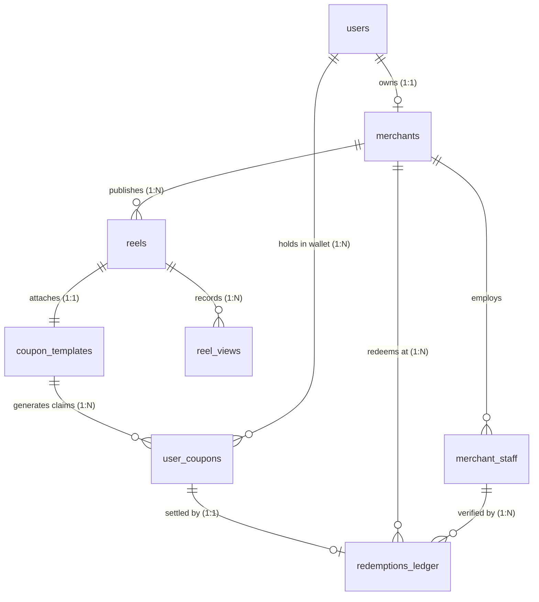
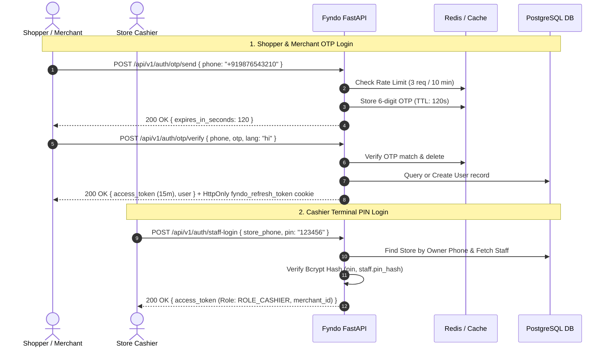
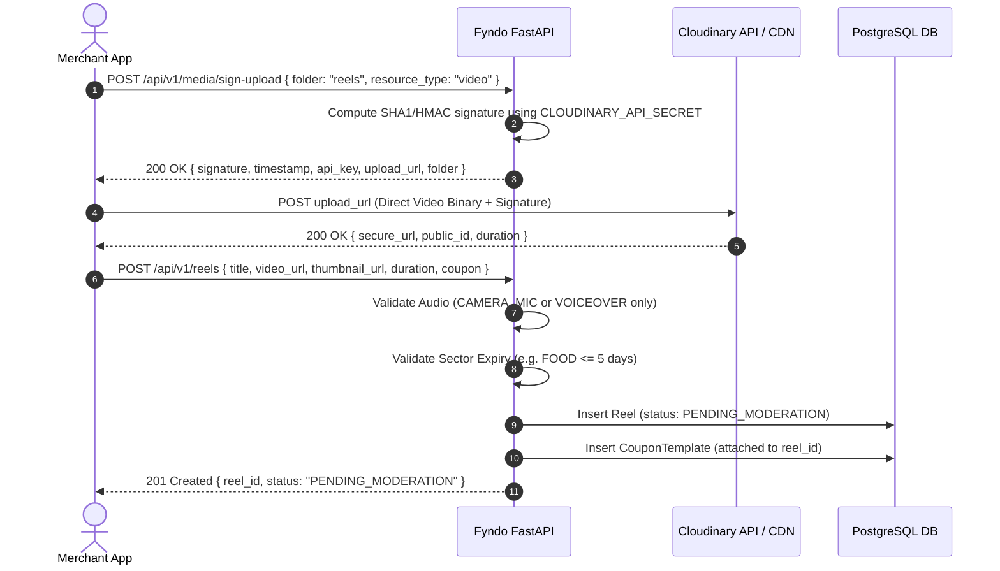
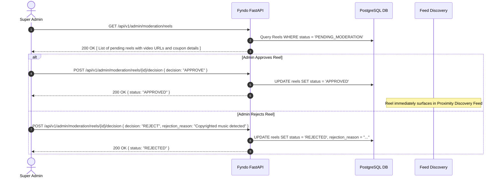
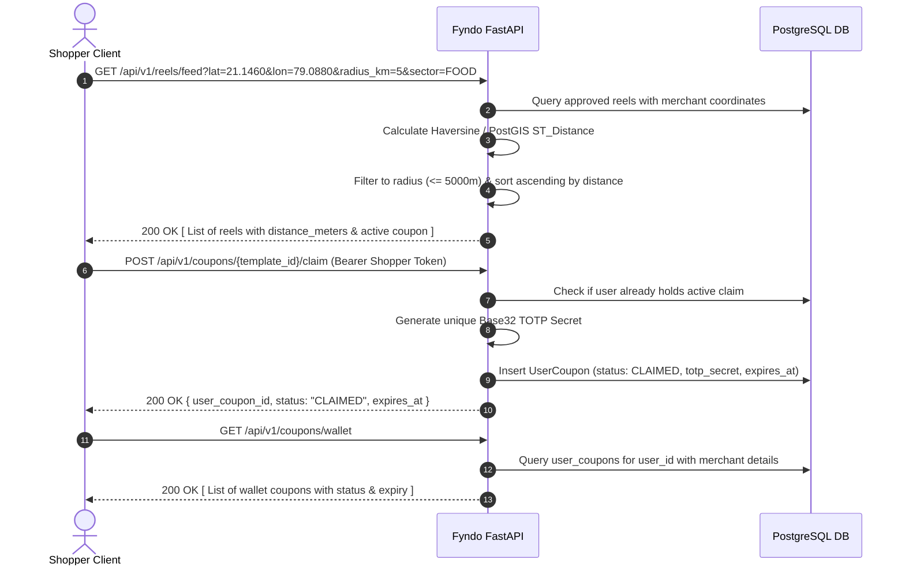
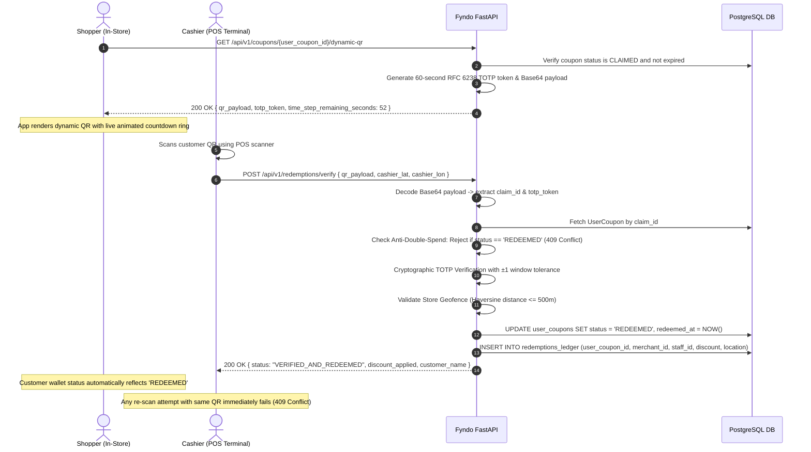

# Fyndo Backend Architecture: Database Schema & Service Flows

> **Platform**: Fyndo (Hyper-Local Video Discovery & In-Store Digital Coupon Platform)  
> **Backend Engine**: FastAPI (Python 3.13) + Async SQLAlchemy 2.0 + PostgreSQL 16 (PostGIS) / SQLite fallback + Redis 7  
> **Media Infrastructure**: Cloudinary (Direct Signed Client Upload + Multi-CDN Delivery)  
> **Security Core**: RFC 6238 60s Dynamic TOTP + Bcrypt Hashed Staff PINs + Dual JWT (Access/Refresh)

---

## 1. Database Schema Specification

### 1.1 Entity-Relationship (ER) Diagram



---

### 1.2 Table Definitions & Data Dictionaries

#### 1. `users`
Represents all system actors (Shoppers, Merchant Owners, Super Admins).
```sql
CREATE TABLE users (
    id UUID PRIMARY KEY DEFAULT gen_random_uuid(),
    phone VARCHAR(15) UNIQUE NOT NULL,            -- Formatted as +91XXXXXXXXXX
    full_name VARCHAR(100) NULL,
    email VARCHAR(255) NULL,
    role VARCHAR(20) NOT NULL DEFAULT 'SHOPPER',  -- SHOPPER, MERCHANT, SUPER_ADMIN
    preferred_language VARCHAR(5) NOT NULL DEFAULT 'en', -- en, hi, mr
    is_active BOOLEAN NOT NULL DEFAULT true,
    created_at TIMESTAMPTZ NOT NULL DEFAULT NOW(),
    updated_at TIMESTAMPTZ NOT NULL DEFAULT NOW()
);
```

#### 2. `merchants`
Stores business profiles, physical store locations, and KYC verification records.
```sql
CREATE TABLE merchants (
    id UUID PRIMARY KEY DEFAULT gen_random_uuid(),
    user_id UUID UNIQUE NOT NULL REFERENCES users(id) ON DELETE CASCADE,
    business_name VARCHAR(150) NOT NULL,
    sector VARCHAR(30) NOT NULL,                  -- FOOD, FASHION, FOOTWEAR, ELECTRONICS, REAL_ESTATE
    address_text TEXT NOT NULL,
    city VARCHAR(50) NOT NULL,                    -- Nagpur, Mumbai
    latitude DOUBLE PRECISION NOT NULL,           -- e.g. 21.1458
    longitude DOUBLE PRECISION NOT NULL,          -- e.g. 79.0882
    gstin VARCHAR(20) NULL,
    kyc_doc_url VARCHAR(500) NOT NULL,            -- Cloudinary document URL
    kyc_status VARCHAR(20) NOT NULL DEFAULT 'PENDING', -- PENDING, APPROVED, REJECTED
    kyc_rejection_reason TEXT NULL,
    created_at TIMESTAMPTZ NOT NULL DEFAULT NOW(),
    updated_at TIMESTAMPTZ NOT NULL DEFAULT NOW()
);
```

#### 3. `merchant_staff`
Store cashier accounts for in-store QR code validation. Staff records have an explicit active/inactive lifecycle.
```sql
CREATE TABLE merchant_staff (
    id UUID PRIMARY KEY DEFAULT gen_random_uuid(),
    merchant_id UUID NOT NULL REFERENCES merchants(id) ON DELETE CASCADE,
    staff_name VARCHAR(100) NOT NULL,
    phone VARCHAR(15) NOT NULL,
    pin_hash VARCHAR(255) NOT NULL,               -- Bcrypt hash of 6-digit staff PIN
    is_active BOOLEAN NOT NULL DEFAULT true,
    created_at TIMESTAMPTZ NOT NULL DEFAULT NOW()
);
```

#### 4. `reels`
Vertical 9:16 reels uploaded by merchants. Strictly raw camera audio or voiceovers.
```sql
CREATE TABLE reels (
    id UUID PRIMARY KEY DEFAULT gen_random_uuid(),
    merchant_id UUID NOT NULL REFERENCES merchants(id) ON DELETE CASCADE,
    title VARCHAR(150) NOT NULL,
    duration_seconds INTEGER NOT NULL CHECK (duration_seconds BETWEEN 15 AND 60),
    video_url VARCHAR(500) NOT NULL,              -- Cloudinary direct MP4 delivery URL
    thumbnail_url VARCHAR(500) NOT NULL,          -- Cloudinary auto-extracted WebP thumbnail
    cloudinary_public_id VARCHAR(255) NULL,
    audio_type VARCHAR(20) NOT NULL DEFAULT 'CAMERA_MIC', -- CAMERA_MIC, VOICEOVER
    status VARCHAR(30) NOT NULL DEFAULT 'PENDING_MODERATION', -- PENDING_MODERATION, APPROVED, REJECTED
    rejection_reason TEXT NULL,
    views_count INTEGER NOT NULL DEFAULT 0,
    created_at TIMESTAMPTZ NOT NULL DEFAULT NOW(),
    updated_at TIMESTAMPTZ NOT NULL DEFAULT NOW(),
    deleted_at TIMESTAMPTZ NULL
);
```

#### 5. `coupon_templates`
Incentive definitions attached 1-to-1 to each reel. Enforces sector validity limits.
```sql
CREATE TABLE coupon_templates (
    id UUID PRIMARY KEY DEFAULT gen_random_uuid(),
    merchant_id UUID NOT NULL REFERENCES merchants(id) ON DELETE CASCADE,
    reel_id UUID UNIQUE NOT NULL REFERENCES reels(id) ON DELETE CASCADE,
    title VARCHAR(100) NOT NULL,
    discount_type VARCHAR(20) NOT NULL,           -- PERCENTAGE, FLAT_AMOUNT, BOGO
    discount_value NUMERIC(10, 2) NOT NULL,
    min_order_amount NUMERIC(10, 2) NOT NULL DEFAULT 0.00,
    validity_days INTEGER NOT NULL,               -- Constrained by sector limits
    terms TEXT NULL,
    is_active BOOLEAN NOT NULL DEFAULT true,
    created_at TIMESTAMPTZ NOT NULL DEFAULT NOW()
);
```

#### 6. `user_coupons`
Shopper claims stored in the digital wallet. Holds the private cryptographic secret for dynamic TOTP QR codes.
```sql
CREATE TABLE user_coupons (
    id UUID PRIMARY KEY DEFAULT gen_random_uuid(),
    coupon_template_id UUID NOT NULL REFERENCES coupon_templates(id),
    user_id UUID NOT NULL REFERENCES users(id),
    status VARCHAR(20) NOT NULL DEFAULT 'CLAIMED', -- CLAIMED, REDEEMED, EXPIRED
    totp_secret VARCHAR(64) NOT NULL,             -- Unique Base32 secret for dynamic QR
    claimed_at TIMESTAMPTZ NOT NULL DEFAULT NOW(),
    expires_at TIMESTAMPTZ NOT NULL,
    redeemed_at TIMESTAMPTZ NULL,
    backup_pin_used_at TIMESTAMPTZ NULL,
    redeemed_by_staff_id UUID NULL REFERENCES merchant_staff(id)
);
```

#### 7. `redemptions_ledger`
Immutable transaction ledger recording every physical in-store redemption with cashier GPS coordinates.
```sql
CREATE TABLE redemptions_ledger (
    id UUID PRIMARY KEY DEFAULT gen_random_uuid(),
    user_coupon_id UUID UNIQUE NOT NULL REFERENCES user_coupons(id),
    merchant_id UUID NOT NULL REFERENCES merchants(id),
    staff_id UUID NULL REFERENCES merchant_staff(id),
    bill_amount NUMERIC(10, 2) NOT NULL,
    discount_applied NUMERIC(10, 2) NOT NULL,
    cashier_latitude DOUBLE PRECISION NULL,
    cashier_longitude DOUBLE PRECISION NULL,
    distance_from_shop_m INTEGER NULL,            -- Verified against 500m geofence perimeter
    created_at TIMESTAMPTZ NOT NULL DEFAULT NOW()
);
```

#### 8. `reel_views`
Records deduplicated authenticated or client-keyed views used to keep `reels.views_count` consistent.
```sql
CREATE TABLE reel_views (
    id UUID PRIMARY KEY DEFAULT gen_random_uuid(),
    reel_id UUID NOT NULL REFERENCES reels(id) ON DELETE CASCADE,
    user_id UUID NULL REFERENCES users(id) ON DELETE SET NULL,
    viewer_key VARCHAR(128) NULL,
    created_at TIMESTAMPTZ NOT NULL DEFAULT NOW()
);
```

---

### 1.3 Sector Validity Limits (Business Rule Engine)

| Sector | Max Coupon Validity | Rationale |
|---|---|---|
| **FOOD** | **2 to 5 Days** | Perishable inventory; prevents hoarding old food deals. |
| **FASHION** | **Max 15 Days** | Seasonal clearance and rotating fashion trends. |
| **FOOTWEAR** | **Max 15 Days** | Retail inventory cycles. |
| **ELECTRONICS** | **Max 15 Days** | Price volatility and distributor margins. |
| **REAL_ESTATE** | **Up to 60 Days** | Long decision cycle for site visits and token booking. |

---

## 2. Backend Service Execution Flows

### Flow 1: Authentication & Staff POS Setup



## 3. Issue-Driven API Contracts

- `PATCH /api/v1/merchants/profile` updates only the authenticated merchant's editable store fields.
- `PATCH /api/v1/merchants/kyc` accepts resubmission only while KYC is `REJECTED`; the existing rejection reason remains available until moderation.
- `GET /api/v1/admin/moderation/merchants` and
  `POST /api/v1/admin/moderation/merchants/{id}/decision` are restricted to `SUPER_ADMIN`.
- `POST /api/v1/reels` requires approved merchant KYC. `GET /api/v1/reels/mine`,
  `GET/PATCH/DELETE /api/v1/reels/{id}`, and `POST /api/v1/reels/{id}/view` provide
  merchant lifecycle, public retrieval, soft deletion, and deduplicated view tracking.
- `POST /api/v1/redemptions/verify` requires a positive `bill_amount`; percentage and
  flat discounts are capped at the bill amount and minimum-order rules are enforced.
  `POST /api/v1/redemptions/verify-pin` applies the same checks with rate-limited backup PINs.
- Refresh tokens are issued in an `HttpOnly` cookie with `SameSite=Lax` in development
  and `SameSite=Strict; Secure` in production. Clients should send requests with credentials.

---

### Flow 2: Merchant Studio & Cloudinary Ingestion Flow



---

### Flow 3: Super Admin Moderation Pipeline



---

### Flow 4: Hyper-Local Keyset Proximity Feed & Wallet Claim



---

### Flow 5: Anti-Fraud In-Store Dynamic TOTP Redemption Loop



---

## 3. Directory Code Structure

```text
backend/app/
├── api/
│   └── v1/
│       ├── api.py                    # Root v1 APIRouter registration
│       └── endpoints/
│           ├── admin.py              # Moderation queue & approve/reject decisions
│           ├── auth.py               # Mobile OTP & Cashier Staff PIN login
│           ├── coupons.py            # Coupon claim & dynamic TOTP QR generator
│           ├── health.py             # Liveness & readiness probes
│           ├── media.py              # Direct Cloudinary signed upload generator
│           ├── merchants.py          # Store onboarding & staff assignment
│           ├── redemptions.py        # In-store POS cashier scanner validation
│           └── reels.py              # Proximity feed & video submission
├── core/
│   ├── config.py                 # Pydantic v2 application settings
│   ├── database.py               # Async SQLAlchemy engine & DB session dependency
│   ├── redis.py                  # Async Redis client with fakeredis fallback
│   └── security.py               # Bcrypt PIN hashing & PyJWT token generator
├── models/
│   ├── coupon.py                 # CouponTemplate, UserCoupon, RedemptionsLedger
│   ├── merchant.py               # Merchant, MerchantStaff
│   ├── reel.py                   # Reel model
│   └── user.py                   # User model
├── schemas/
│   ├── admin.py                  # Moderation decision & admin reel schemas
│   ├── auth.py                   # OTP & Staff login schemas
│   ├── common.py                 # Standard Success/Error ResponseEnvelope
│   ├── coupon.py                 # Dynamic QR, wallet item & redemption schemas
│   ├── media.py                  # Cloudinary signature request/response schemas
│   ├── merchant.py               # Onboarding & staff creation schemas
│   └── reel.py                   # Reel submission & proximity feed schemas
├── services/
│   ├── cloudinary_service.py     # HMAC upload signature generation
│   ├── otp.py                    # 6-digit OTP dispatch & rate-limiting
│   └── totp.py                   # RFC 6238 60s dynamic QR generator & validator
└── utils/
    └── geo.py                    # Haversine distance calculator
```
