# Fyndo Backend Architecture: Database Schema & Service Flows

> **Platform**: Fyndo (Hyper-Local Video Discovery & In-Store Digital Coupon Platform)  
> **Backend Engine**: FastAPI (Python 3.13) + Async SQLAlchemy 2.0 + PostgreSQL 16 (PostGIS) / SQLite fallback + Redis 7  
> **Media Infrastructure**: Cloudinary (Direct Signed Client Upload + Multi-CDN Delivery)  
> **Security Core**: RFC 6238 60s Dynamic TOTP + Bcrypt Hashed Staff PINs + Dual JWT (Access/Refresh)

---

## 1. Database Schema Specification

### 1.1 Entity-Relationship (ER) Diagram

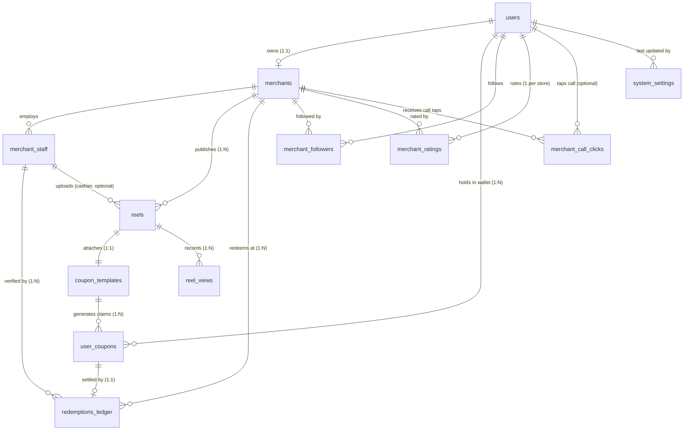

---

### 1.2 Table Definitions & Data Dictionaries

#### 1. `users`
Represents all system actors (Shoppers, Merchant Owners, Super Admins).
```sql
CREATE TABLE users (
    id UUID PRIMARY KEY DEFAULT gen_random_uuid(),
    phone VARCHAR(15) UNIQUE NOT NULL,            -- Formatted as +91XXXXXXXXXX
    full_name VARCHAR(100) NULL,
    email VARCHAR(255) NULL,
    role VARCHAR(20) NOT NULL DEFAULT 'SHOPPER',  -- SHOPPER, MERCHANT, SUPER_ADMIN
    preferred_language VARCHAR(5) NOT NULL DEFAULT 'en', -- en, hi, mr
    is_active BOOLEAN NOT NULL DEFAULT true,
    created_at TIMESTAMPTZ NOT NULL DEFAULT NOW(),
    updated_at TIMESTAMPTZ NOT NULL DEFAULT NOW()
);
```

#### 2. `merchants`
Stores business profiles, physical store locations, and KYC verification records.
```sql
CREATE TABLE merchants (
    id UUID PRIMARY KEY DEFAULT gen_random_uuid(),
    user_id UUID UNIQUE NOT NULL REFERENCES users(id) ON DELETE CASCADE,
    business_name VARCHAR(150) NOT NULL,
    sector VARCHAR(30) NOT NULL,                  -- FOOD, FASHION, FOOTWEAR, ELECTRONICS, REAL_ESTATE
    address_text TEXT NOT NULL,
    city VARCHAR(50) NOT NULL,                    -- Nagpur, Mumbai
    latitude DOUBLE PRECISION NOT NULL,           -- e.g. 21.1458
    longitude DOUBLE PRECISION NOT NULL,          -- e.g. 79.0882
    gstin VARCHAR(20) NULL,
    kyc_doc_url VARCHAR(500) NOT NULL,            -- Cloudinary document URL
    kyc_status VARCHAR(20) NOT NULL DEFAULT 'PENDING', -- PENDING, APPROVED, REJECTED
    kyc_rejection_reason TEXT NULL,
    profile_video_url VARCHAR(500) NULL,          -- Permanent storefront video (never expires)
    profile_video_thumbnail_url VARCHAR(500) NULL,
    call_clicks_count INTEGER NOT NULL DEFAULT 0, -- Cached total of counted "Call store" taps
    created_at TIMESTAMPTZ NOT NULL DEFAULT NOW(),
    updated_at TIMESTAMPTZ NOT NULL DEFAULT NOW()
);
```

#### 3. `merchant_staff`
Store cashier accounts for in-store QR code validation. Staff records have an explicit active/inactive lifecycle.
```sql
CREATE TABLE merchant_staff (
    id UUID PRIMARY KEY DEFAULT gen_random_uuid(),
    merchant_id UUID NOT NULL REFERENCES merchants(id) ON DELETE CASCADE,
    staff_name VARCHAR(100) NOT NULL,
    phone VARCHAR(15) NOT NULL,
    pin_hash VARCHAR(255) NOT NULL,               -- Bcrypt hash of 6-digit staff PIN
    is_active BOOLEAN NOT NULL DEFAULT true,
    can_upload_reels BOOLEAN NOT NULL DEFAULT false, -- Owner-granted reel upload permission
    created_at TIMESTAMPTZ NOT NULL DEFAULT NOW()
);
```

#### 4. `reels`
Vertical 9:16 reels uploaded by merchants. Strictly raw camera audio or voiceovers.
```sql
CREATE TABLE reels (
    id UUID PRIMARY KEY DEFAULT gen_random_uuid(),
    merchant_id UUID NOT NULL REFERENCES merchants(id) ON DELETE CASCADE,
    title VARCHAR(150) NOT NULL,
    duration_seconds INTEGER NOT NULL CHECK (duration_seconds BETWEEN 15 AND 60),
    video_url VARCHAR(500) NOT NULL,              -- Cloudinary direct MP4 delivery URL
    thumbnail_url VARCHAR(500) NOT NULL,          -- Cloudinary auto-extracted WebP thumbnail
    cloudinary_public_id VARCHAR(255) NULL,
    audio_type VARCHAR(20) NOT NULL DEFAULT 'CAMERA_MIC', -- CAMERA_MIC, VOICEOVER
    status VARCHAR(30) NOT NULL DEFAULT 'PENDING_MODERATION', -- PENDING_MODERATION, APPROVED, REJECTED
    rejection_reason TEXT NULL,
    views_count INTEGER NOT NULL DEFAULT 0,
    allow_comments BOOLEAN NOT NULL DEFAULT true,
    created_at TIMESTAMPTZ NOT NULL DEFAULT NOW(),
    updated_at TIMESTAMPTZ NOT NULL DEFAULT NOW(),
    deleted_at TIMESTAMPTZ NULL,                  -- Soft delete (owner, or auto after grace window)
    expires_at TIMESTAMPTZ NULL,                  -- Offer end; set when the reel goes live
    grace_period_until TIMESTAMPTZ NULL,          -- expires_at + 24h: last moment to extend
    is_expired BOOLEAN NOT NULL DEFAULT false,    -- Set by the lifecycle sweep
    created_by_staff_id UUID NULL REFERENCES merchant_staff(id) ON DELETE SET NULL -- Cashier uploader
);
```

#### 5. `coupon_templates`
Incentive definitions attached 1-to-1 to each reel. Enforces sector validity limits.
```sql
CREATE TABLE coupon_templates (
    id UUID PRIMARY KEY DEFAULT gen_random_uuid(),
    merchant_id UUID NOT NULL REFERENCES merchants(id) ON DELETE CASCADE,
    reel_id UUID UNIQUE NOT NULL REFERENCES reels(id) ON DELETE CASCADE,
    title VARCHAR(100) NOT NULL,
    discount_type VARCHAR(20) NOT NULL,           -- PERCENTAGE, FLAT_AMOUNT, BOGO
    discount_value NUMERIC(10, 2) NOT NULL,
    min_order_amount NUMERIC(10, 2) NOT NULL DEFAULT 0.00,
    validity_days INTEGER NOT NULL,               -- Constrained by sector limits
    terms TEXT NULL,
    is_active BOOLEAN NOT NULL DEFAULT true,
    expires_at TIMESTAMPTZ NULL,                  -- Mirrors reels.expires_at; claims refused after it
    created_at TIMESTAMPTZ NOT NULL DEFAULT NOW()
);
```

#### 6. `user_coupons`
Shopper claims stored in the digital wallet. Holds the private cryptographic secret for dynamic TOTP QR codes.
```sql
CREATE TABLE user_coupons (
    id UUID PRIMARY KEY DEFAULT gen_random_uuid(),
    coupon_template_id UUID NOT NULL REFERENCES coupon_templates(id),
    user_id UUID NOT NULL REFERENCES users(id),
    status VARCHAR(20) NOT NULL DEFAULT 'CLAIMED', -- CLAIMED, REDEEMED, EXPIRED
    totp_secret VARCHAR(64) NOT NULL,             -- Unique Base32 secret for dynamic QR
    claimed_at TIMESTAMPTZ NOT NULL DEFAULT NOW(),
    expires_at TIMESTAMPTZ NOT NULL,
    redeemed_at TIMESTAMPTZ NULL,
    backup_pin_used_at TIMESTAMPTZ NULL,
    redeemed_by_staff_id UUID NULL REFERENCES merchant_staff(id)
);
```

#### 7. `redemptions_ledger`
Immutable transaction ledger recording every physical in-store redemption with cashier GPS coordinates.
```sql
CREATE TABLE redemptions_ledger (
    id UUID PRIMARY KEY DEFAULT gen_random_uuid(),
    user_coupon_id UUID UNIQUE NOT NULL REFERENCES user_coupons(id),
    merchant_id UUID NOT NULL REFERENCES merchants(id),
    staff_id UUID NULL REFERENCES merchant_staff(id),
    bill_amount NUMERIC(10, 2) NOT NULL,
    discount_applied NUMERIC(10, 2) NOT NULL,
    cashier_latitude DOUBLE PRECISION NULL,
    cashier_longitude DOUBLE PRECISION NULL,
    distance_from_shop_m INTEGER NULL,            -- Verified against 500m geofence perimeter
    created_at TIMESTAMPTZ NOT NULL DEFAULT NOW()
);
```

#### 8. `reel_views`
Records deduplicated authenticated or client-keyed views used to keep `reels.views_count` consistent.
```sql
CREATE TABLE reel_views (
    id UUID PRIMARY KEY DEFAULT gen_random_uuid(),
    reel_id UUID NOT NULL REFERENCES reels(id) ON DELETE CASCADE,
    user_id UUID NULL REFERENCES users(id) ON DELETE SET NULL,
    viewer_key VARCHAR(128) NULL,
    created_at TIMESTAMPTZ NOT NULL DEFAULT NOW()
);
```

#### 9. `merchant_followers`
Shoppers following stores (client requirement 4).
```sql
CREATE TABLE merchant_followers (
    id UUID PRIMARY KEY DEFAULT gen_random_uuid(),
    merchant_id UUID NOT NULL REFERENCES merchants(id) ON DELETE CASCADE,
    user_id UUID NOT NULL REFERENCES users(id) ON DELETE CASCADE,
    created_at TIMESTAMPTZ NOT NULL DEFAULT NOW(),
    CONSTRAINT uq_merchant_follower UNIQUE (merchant_id, user_id)
);
CREATE INDEX ix_merchant_followers_merchant_id ON merchant_followers(merchant_id);
CREATE INDEX ix_merchant_followers_user_id ON merchant_followers(user_id);
```

#### 10. `merchant_call_clicks`
One row per counted "Call store" tap (client requirement 3). Taps by the same user/device within 60s count once.
```sql
CREATE TABLE merchant_call_clicks (
    id UUID PRIMARY KEY DEFAULT gen_random_uuid(),
    merchant_id UUID NOT NULL REFERENCES merchants(id) ON DELETE CASCADE,
    user_id UUID NULL REFERENCES users(id) ON DELETE SET NULL,
    device_fingerprint VARCHAR(128) NULL,         -- App install id for anonymous de-duplication
    created_at TIMESTAMPTZ NOT NULL DEFAULT NOW()
);
CREATE INDEX ix_call_clicks_merchant_created ON merchant_call_clicks(merchant_id, created_at);
```

#### 11. `merchant_ratings`
One 1-5 star rating per shopper per store; re-rating updates the row (client requirement 11).
```sql
CREATE TABLE merchant_ratings (
    id UUID PRIMARY KEY DEFAULT gen_random_uuid(),
    merchant_id UUID NOT NULL REFERENCES merchants(id) ON DELETE CASCADE,
    user_id UUID NOT NULL REFERENCES users(id) ON DELETE CASCADE,
    rating SMALLINT NOT NULL CHECK (rating >= 1 AND rating <= 5),
    review_text TEXT NULL,
    created_at TIMESTAMPTZ NOT NULL DEFAULT NOW(),
    updated_at TIMESTAMPTZ NOT NULL DEFAULT NOW(),
    CONSTRAINT uq_merchant_user_rating UNIQUE (merchant_id, user_id)
);
CREATE INDEX ix_merchant_ratings_merchant_id ON merchant_ratings(merchant_id);
```

#### 12. `system_settings`
Runtime switches flipped by the Super Admin (client requirement 10).
```sql
CREATE TABLE system_settings (
    key VARCHAR(50) PRIMARY KEY,                  -- e.g. 'auto_approve_reels'
    value JSON NOT NULL,                          -- auto_approve_reels: true | false (default false)
    description VARCHAR(255) NULL,
    updated_at TIMESTAMPTZ NOT NULL DEFAULT NOW(),
    updated_by_user_id UUID NULL REFERENCES users(id) ON DELETE SET NULL
);
```
A missing row means "use the default" (`SETTING_DEFAULTS` in `app/models/system_settings.py`), so no seed step is needed.

#### Schema rollout (no Alembic)
New **tables** are created by `Base.metadata.create_all` at startup. New **columns** on existing tables are added by
`ensure_compatibility_schema()` in `app/core/database.py` (the `_COMPAT_COLUMNS` map, with SQLite and PostgreSQL DDL),
which runs once per process before the first request. Restarting the API is enough to upgrade an existing database.

---

### 1.3 Sector Validity Limits (Business Rule Engine)

| Sector | Max Coupon Validity | Rationale |
|---|---|---|
| **FOOD** | **2 to 5 Days** | Perishable inventory; prevents hoarding old food deals. |
| **FASHION** | **Max 15 Days** | Seasonal clearance and rotating fashion trends. |
| **FOOTWEAR** | **Max 15 Days** | Retail inventory cycles. |
| **ELECTRONICS** | **Max 15 Days** | Price volatility and distributor margins. |
| **REAL_ESTATE** | **Up to 60 Days** | Long decision cycle for site visits and token booking. |

The same ceilings cap offer extensions (`POST /reels/{id}/extend-validity`).

---

## 2. Backend Service Execution Flows

### Flow 1: Authentication & Staff POS Setup

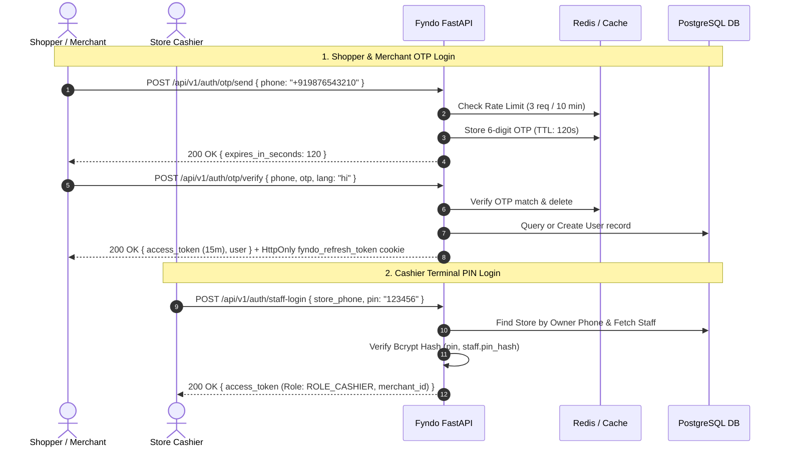

## 3. Issue-Driven API Contracts

- `PATCH /api/v1/merchants/profile` updates only the authenticated merchant's editable store fields.
- `PATCH /api/v1/merchants/kyc` accepts resubmission only while KYC is `REJECTED`; the existing rejection reason remains available until moderation.
- `GET /api/v1/admin/moderation/merchants` and
  `POST /api/v1/admin/moderation/merchants/{id}/decision` are restricted to `SUPER_ADMIN`.
- `POST /api/v1/reels` requires approved merchant KYC and accepts the store owner **or** a cashier with
  `can_upload_reels`. Shopper-facing reel queries hide offers past `expires_at`. `GET /api/v1/reels/mine`,
  `GET/PATCH/DELETE /api/v1/reels/{id}`, and `POST /api/v1/reels/{id}/view` provide
  merchant lifecycle, public retrieval, soft deletion, and deduplicated view tracking.
- `POST /api/v1/redemptions/verify` requires a positive `bill_amount`; percentage and
  flat discounts are capped at the bill amount and minimum-order rules are enforced.
  `POST /api/v1/redemptions/verify-pin` applies the same checks with rate-limited backup PINs.
- Refresh tokens are issued in an `HttpOnly` cookie with `SameSite=Lax` in development
  and `SameSite=Strict; Secure` in production. Clients should send requests with credentials.

---

### Flow 2: Merchant Studio & Cloudinary Ingestion Flow

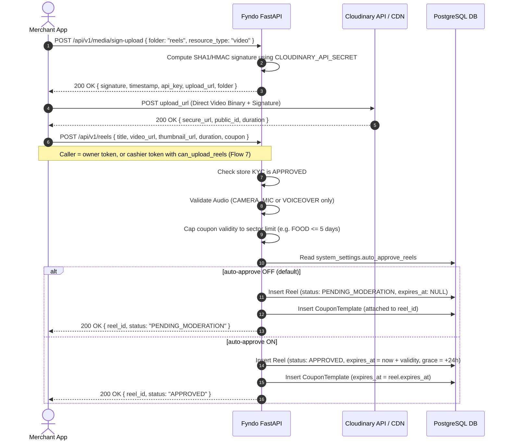

---

### Flow 3: Super Admin Moderation Pipeline

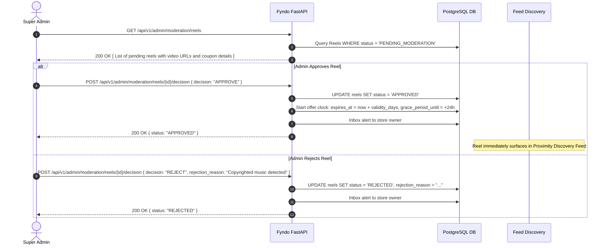
> With auto-approve ON (Flow 8) new reels skip this queue. Reels already pending stay pending.

---

### Flow 4: Hyper-Local Keyset Proximity Feed & Wallet Claim

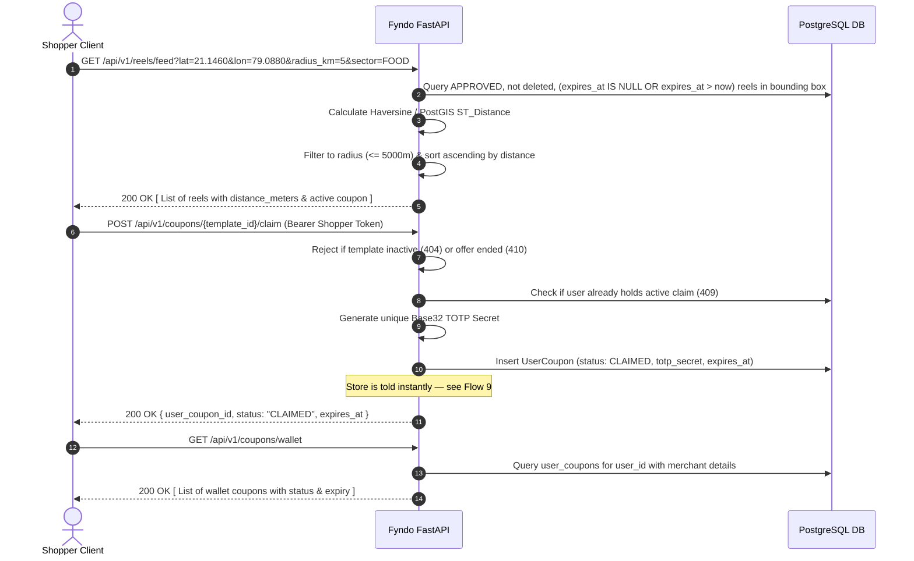

---

### Flow 5: Anti-Fraud In-Store Dynamic TOTP Redemption Loop

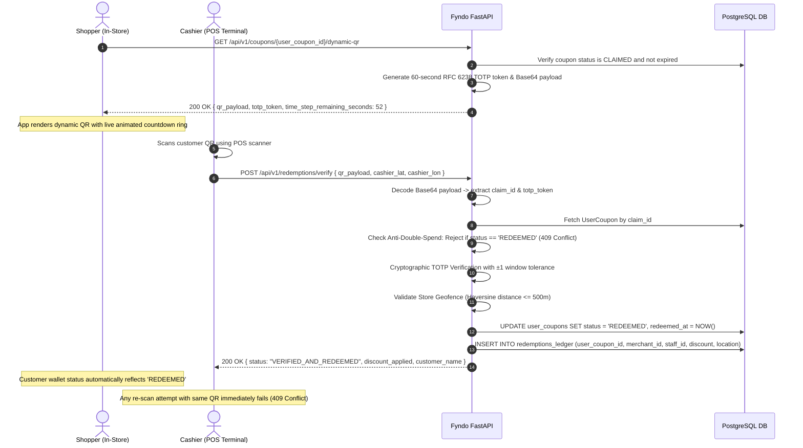

---

### Flow 6: Storefront — Profile Video, Follow, Call Tap & Rating
Client requirements 2, 3, 4, 11.

```mermaid
sequenceDiagram
    autonumber
    actor Owner as Store Owner
    actor Shopper as Shopper App
    participant API as Fyndo FastAPI
    participant Cloudinary as Cloudinary
    participant DB as PostgreSQL DB

    Note over Owner, DB: Permanent store video (never expires)
    Owner->>API: POST /api/v1/media/sign-upload { resource_type: "video" }
    API-->>Owner: 200 OK { signature, upload_url, ... }
    Owner->>Cloudinary: Upload store video
    Cloudinary-->>Owner: { secure_url }
    Owner->>API: PATCH /api/v1/merchants/me/profile-video { profile_video_url, profile_video_thumbnail_url }
    API->>DB: UPDATE merchants SET profile_video_url, profile_video_thumbnail_url
    API-->>Owner: 200 OK

    Note over Shopper, DB: Shopper opens the storefront
    Shopper->>API: GET /api/v1/merchants/{id} (token optional)
    API->>DB: Store + COUNT(followers) + is_following + AVG/COUNT(ratings)
    API-->>Shopper: 200 OK { profile_video_url, followers_count, is_following, rating_average, rating_count }

    Shopper->>API: POST /api/v1/merchants/{id}/follow
    alt not following yet
        API->>DB: INSERT merchant_followers (unique merchant_id+user_id)
        API-->>Shopper: { is_following: true, followers_count }
    else already following
        API->>DB: DELETE merchant_followers row
        API-->>Shopper: { is_following: false, followers_count }
    end

    Shopper->>API: POST /api/v1/merchants/{id}/track-call { device_fingerprint? }
    API->>DB: Same user/device tapped this store in last 60s?
    alt first tap in window
        API->>DB: INSERT merchant_call_clicks + merchants.call_clicks_count += 1 (atomic)
        API-->>Shopper: { counted: true }
    else repeat tap
        API-->>Shopper: { counted: false }
    end
    Shopper->>Shopper: Open phone dialer

    Shopper->>API: POST /api/v1/merchants/{id}/rate { rating: 4, review_text }
    API->>DB: Upsert merchant_ratings (one row per shopper per store)
    API-->>Shopper: 200 OK { rating, review_text, user_name }

    Owner->>API: GET /api/v1/merchants/me/insights
    API->>DB: followers, call taps (total + 7 days), SUM(reel views), rating avg/count
    API-->>Owner: 200 OK { followers_count, call_clicks_total, ... }
```
Owners cannot follow or rate their own store (`400`).

---

### Flow 7: Cashier Reel Upload Permission
Client requirements 6 & 7.

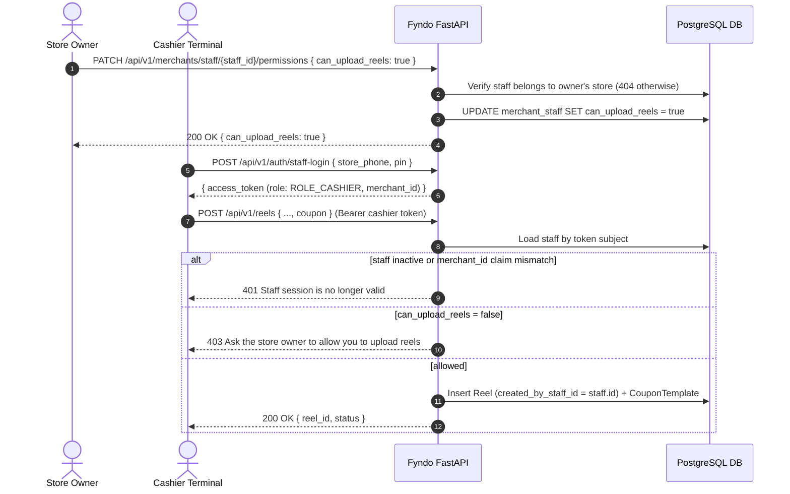
The permission is re-read from the database on every upload, so revoking it takes effect on the cashier's next attempt.
Cashiers cannot extend offers; only the owner can.

---

### Flow 8: Admin Auto-Approve Switch
Client requirement 10.

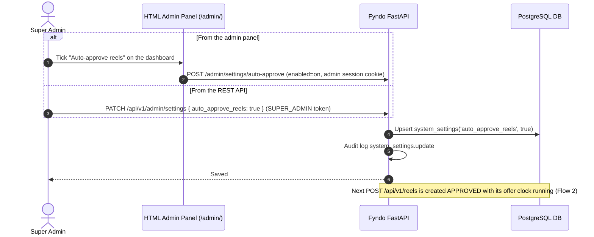

---

### Flow 9: Real-Time "Coupon Claimed" Alert to the Store (WebSocket)
Client requirement 9.

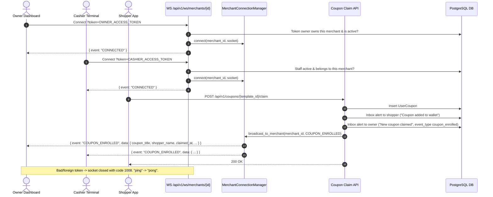
Delivery is best-effort: a failed broadcast never fails the claim, and dead sockets are dropped. If the owner was offline,
the inbox alert is still there. Connections live in one process; several API workers would need Redis pub/sub.

---

### Flow 10: Offer Expiry, 24-Hour Grace Window & Auto-Removal
Client requirements 8 & 12.

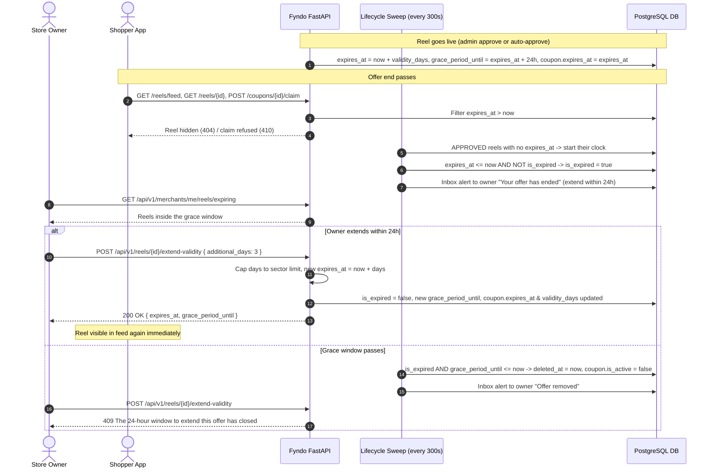
Coupons already in shoppers' wallets keep their own expiry and remain redeemable. The sweep runs inside the API
process (`REEL_LIFECYCLE_SWEEP_SECONDS`, `0` disables it); it is idempotent, so running it more often is safe.

---

## 3. Directory Code Structure

```text
backend/app/
├── api/
│   └── v1/
│       ├── api.py                    # Root v1 APIRouter registration
│       └── endpoints/
│           ├── admin.py              # Moderation queue & approve/reject decisions
│           ├── admin_settings.py     # Super Admin settings (auto_approve_reels)
│           ├── auth.py               # Mobile OTP & Cashier Staff PIN login
│           ├── coupons.py            # Coupon claim & dynamic TOTP QR generator
│           ├── health.py             # Liveness & readiness probes
│           ├── media.py              # Direct Cloudinary signed upload generator
│           ├── merchant_engagement.py # Profile video, follow, call taps, ratings, cashier permission, insights
│           ├── merchants.py          # Store onboarding, staff assignment, public storefront
│           ├── redemptions.py        # In-store POS cashier scanner validation
│           ├── reel_publishing.py    # Create reel (owner/cashier), extend offer, expiring list
│           ├── reels.py              # Proximity feed, reel detail, merchant reel management
│           └── ws.py                 # WebSocket channel for store screens
├── core/
│   ├── config.py                 # Pydantic v2 application settings
│   ├── database.py               # Async SQLAlchemy engine & DB session dependency
│   ├── redis.py                  # Async Redis client with fakeredis fallback
│   └── security.py               # Bcrypt PIN hashing & PyJWT token generator
├── models/
│   ├── coupon.py                 # CouponTemplate, UserCoupon, RedemptionsLedger
│   ├── merchant.py               # Merchant, MerchantStaff
│   ├── merchant_engagement.py    # MerchantFollower, MerchantCallClick, MerchantRating
│   ├── reel.py                   # Reel model (+ offer lifecycle columns)
│   ├── system_settings.py        # SystemSetting + defaults
│   └── user.py                   # User model
├── schemas/
│   ├── admin.py                  # Moderation decision & admin reel schemas
│   ├── auth.py                   # OTP & Staff login schemas
│   ├── common.py                 # Standard Success/Error ResponseEnvelope
│   ├── coupon.py                 # Dynamic QR, wallet item & redemption schemas
│   ├── media.py                  # Cloudinary signature request/response schemas
│   ├── merchant.py               # Onboarding & staff creation schemas
│   ├── merchant_engagement.py    # Follow, rating, call-tap, profile video, insights schemas
│   └── reel.py                   # Reel submission & proximity feed schemas
├── services/
│   ├── cloudinary_service.py     # HMAC upload signature generation
│   ├── coupon_alerts.py          # Owner inbox alert + COUPON_ENROLLED broadcast on claim
│   ├── merchant_engagement_service.py # Follow / call-tap / rating / insights logic
│   ├── otp.py                    # 6-digit OTP dispatch & rate-limiting
│   ├── reel_lifecycle_service.py # Offer clock, extension, expiry/grace sweep
│   ├── settings_service.py       # Read/write system_settings
│   ├── socket_service.py         # In-process WebSocket connection manager
│   └── totp.py                   # RFC 6238 60s dynamic QR generator & validator
└── utils/
    └── geo.py                    # Haversine distance calculator
```
