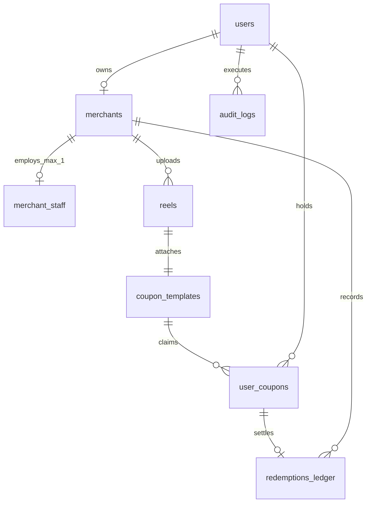

# 06 - Database Design Document

> **Database Engine**: PostgreSQL 16 + PostGIS Extension  
> **Naming Conventions**: `snake_case` for tables and columns, plural table names, UUID primary keys.

---

## 1. Entity-Relationship Model Overview



---

## 2. Table Specifications & Schemas

### 2.1 `users`
Core user account record supporting shoppers, merchants, and administrators.

| Column | Type | Constraints | Description |
|---|---|---|---|
| `id` | `UUID` | `PRIMARY KEY DEFAULT gen_random_uuid()` | Unique user identifier |
| `phone` | `VARCHAR(15)` | `UNIQUE NOT NULL` | Indian phone number with prefix (`+919876543210`) |
| `full_name` | `VARCHAR(100)` | `NULL` | User's full name |
| `email` | `VARCHAR(255)` | `NULL` | Optional email address |
| `username` | `VARCHAR(30)` | `NULL` | Public display handle shown on reel comments |
| `profile_image_url` | `VARCHAR(500)` | `NULL` | Avatar shown alongside reel comments |
| `password_hash` | `VARCHAR(255)` | `NULL` | Bcrypt hash for Super Admin / credential logins |
| `role` | `VARCHAR(20)` | `NOT NULL DEFAULT 'SHOPPER'` | Enum: `SHOPPER`, `MERCHANT`, `SUPER_ADMIN` |
| `preferred_language` | `VARCHAR(5)` | `NOT NULL DEFAULT 'en'` | Enum: `en`, `hi`, `mr` |
| `is_active` | `BOOLEAN` | `NOT NULL DEFAULT true` | Account status flag |
| `created_at` | `TIMESTAMPTZ` | `NOT NULL DEFAULT NOW()` | Record creation timestamp |
| `updated_at` | `TIMESTAMPTZ` | `NOT NULL DEFAULT NOW()` | Record update timestamp |

---

### 2.2 `merchants`
Business entity associated with a merchant user account.

| Column | Type | Constraints | Description |
|---|---|---|---|
| `id` | `UUID` | `PRIMARY KEY DEFAULT gen_random_uuid()` | Unique merchant identifier |
| `user_id` | `UUID` | `UNIQUE NOT NULL REFERENCES users(id)` | Owner user account |
| `business_name` | `VARCHAR(150)` | `NOT NULL` | Registered trading name of store |
| `sector` | `VARCHAR(30)` | `NOT NULL` | Enum: `FOOD`, `FASHION`, `FOOTWEAR`, `ELECTRONICS`, `REAL_ESTATE` |
| `address_text` | `TEXT` | `NOT NULL` | Full physical street address |
| `city` | `VARCHAR(50)` | `NOT NULL` | Beta city (`Nagpur`, `Mumbai`) |
| `location` | `geography(Point, 4326)` | `NOT NULL` | WGS84 GPS coordinate point (Lon, Lat) |
| `gstin` | `VARCHAR(20)` | `NULL` | GST identification number |
| `kyc_doc_url` | `VARCHAR(500)` | `NOT NULL` | Cloudinary secure URL for GST/Gumasta document |
| `kyc_status` | `VARCHAR(20)` | `NOT NULL DEFAULT 'PENDING'` | Enum: `PENDING`, `APPROVED`, `REJECTED` |
| `kyc_rejection_reason` | `TEXT` | `NULL` | Admin remarks if rejected |
| `profile_video_url` | `VARCHAR(500)` | `NULL` | Permanent storefront video (never expires, unlike reels) |
| `profile_video_thumbnail_url` | `VARCHAR(500)` | `NULL` | Poster image for the storefront video |
| `call_clicks_count` | `INTEGER` | `NOT NULL DEFAULT 0` | Cached total of "Call store" taps (detail in `merchant_call_clicks`) |
| `created_at` | `TIMESTAMPTZ` | `NOT NULL DEFAULT NOW()` | Timestamp created |
| `updated_at` | `TIMESTAMPTZ` | `NOT NULL DEFAULT NOW()` | Timestamp updated |

---

### 2.3 `merchant_staff`
Store POS cashier and accountant credentials. Strictly 1 staff per merchant in Beta.

| Column | Type | Constraints | Description |
|---|---|---|---|
| `id` | `UUID` | `PRIMARY KEY DEFAULT gen_random_uuid()` | Unique staff identifier |
| `merchant_id` | `UUID` | `UNIQUE NOT NULL REFERENCES merchants(id) ON DELETE CASCADE` | Associated store (Max 1 per merchant) |
| `staff_name` | `VARCHAR(100)` | `NOT NULL` | Cashier or manager name |
| `phone` | `VARCHAR(15)` | `NOT NULL` | Staff personal phone |
| `pin_hash` | `VARCHAR(255)` | `NOT NULL` | Bcrypt/Argon2 hash of 6-digit scanner PIN |
| `is_active` | `BOOLEAN` | `NOT NULL DEFAULT true` | Active toggle |
| `can_upload_reels` | `BOOLEAN` | `NOT NULL DEFAULT false` | Owner-granted permission to publish reels from the cashier login |
| `created_at` | `TIMESTAMPTZ` | `NOT NULL DEFAULT NOW()` | Timestamp created |
| `updated_at` | `TIMESTAMPTZ` | `NOT NULL DEFAULT NOW()` | Timestamp updated |

---

### 2.4 `reels`
Short video reels uploaded by verified merchants.

| Column | Type | Constraints | Description |
|---|---|---|---|
| `id` | `UUID` | `PRIMARY KEY DEFAULT gen_random_uuid()` | Unique reel identifier |
| `merchant_id` | `UUID` | `NOT NULL REFERENCES merchants(id) ON DELETE CASCADE` | Creator merchant |
| `title` | `VARCHAR(150)` | `NOT NULL` | Reel headline / caption |
| `duration_seconds` | `SMALLINT` | `NOT NULL CHECK (duration_seconds BETWEEN 15 AND 60)` | Video length (15 to 60s) |
| `video_url` | `VARCHAR(500)` | `NOT NULL` | Streamable MP4/WebM video CDN URL |
| `video_hls_url` | `VARCHAR(500)` | `NULL` | Future HLS `playlist.m3u8` CDN URL (deferred) |
| `thumbnail_url` | `VARCHAR(500)` | `NOT NULL` | Poster thumbnail CDN URL |
| `cloudinary_public_id` | `VARCHAR(255)` | `NULL` | Cloudinary asset identifier for lifecycle management |
| `audio_type` | `VARCHAR(20)` | `NOT NULL` | Enum: `CAMERA_MIC`, `VOICEOVER` |
| `allow_comments` | `BOOLEAN` | `NOT NULL DEFAULT true` | Per-reel comments toggle |
| `status` | `VARCHAR(30)` | `NOT NULL DEFAULT 'PENDING_MODERATION'` | Enum: `PENDING_MODERATION`, `APPROVED`, `REJECTED` |
| `rejection_reason` | `TEXT` | `NULL` | Admin rejection feedback |
| `views_count` | `INTEGER` | `NOT NULL DEFAULT 0` | Total shopper view impressions |
| `created_at` | `TIMESTAMPTZ` | `NOT NULL DEFAULT NOW()` | Upload timestamp |
| `updated_at` | `TIMESTAMPTZ` | `NOT NULL DEFAULT NOW()` | Update timestamp |
| `deleted_at` | `TIMESTAMPTZ` | `NULL` | Soft-delete timestamp |
| `expires_at` | `TIMESTAMPTZ` | `NULL` | Offer end; set when the reel goes live (`now + validity_days`). Hidden from shoppers after this |
| `grace_period_until` | `TIMESTAMPTZ` | `NULL` | `expires_at + 24h`; owner may extend until then, after which the reel is soft-deleted |
| `is_expired` | `BOOLEAN` | `NOT NULL DEFAULT false` | Set by the lifecycle sweep once `expires_at` passes |
| `created_by_staff_id` | `UUID` | `NULL REFERENCES merchant_staff(id) ON DELETE SET NULL` | Cashier who uploaded the reel (NULL = owner) |

---

### 2.5 `coupon_templates`
Offer rules and terms attached to an approved reel.

| Column | Type | Constraints | Description |
|---|---|---|---|
| `id` | `UUID` | `PRIMARY KEY DEFAULT gen_random_uuid()` | Unique template identifier |
| `merchant_id` | `UUID` | `NOT NULL REFERENCES merchants(id) ON DELETE CASCADE` | Merchant issuing offer |
| `reel_id` | `UUID` | `UNIQUE NOT NULL REFERENCES reels(id) ON DELETE CASCADE` | 1-to-1 attached reel |
| `title` | `VARCHAR(100)` | `NOT NULL` | E.g., "Flat 20% Off Festive Wear" |
| `discount_type` | `VARCHAR(20)` | `NOT NULL` | Enum: `PERCENTAGE`, `FLAT_AMOUNT`, `BOGO` |
| `discount_value` | `NUMERIC(10, 2)` | `NOT NULL CHECK (discount_value > 0)` | % or ₹ discount value |
| `min_order_amount` | `NUMERIC(10, 2)` | `NOT NULL DEFAULT 0.00` | Minimum bill requirement in ₹ |
| `validity_days` | `SMALLINT` | `NOT NULL` | Max days valid from claim (Sector constrained) |
| `terms` | `TEXT` | `NULL` | Specific conditions & exclusions |
| `is_active` | `BOOLEAN` | `NOT NULL DEFAULT true` | Availability toggle |
| `expires_at` | `TIMESTAMPTZ` | `NULL` | Mirrors the parent reel's offer end; claims are refused after it |
| `created_at` | `TIMESTAMPTZ` | `NOT NULL DEFAULT NOW()` | Timestamp created |
| `updated_at` | `TIMESTAMPTZ` | `NOT NULL DEFAULT NOW()` | Timestamp updated |

---

### 2.6 `user_coupons`
Individual instances of coupons claimed by shoppers into their wallet.

| Column | Type | Constraints | Description |
|---|---|---|---|
| `id` | `UUID` | `PRIMARY KEY DEFAULT gen_random_uuid()` | Unique coupon claim identifier |
| `coupon_template_id` | `UUID` | `NOT NULL REFERENCES coupon_templates(id)` | Parent coupon definition |
| `user_id` | `UUID` | `NOT NULL REFERENCES users(id)` | Claiming shopper |
| `status` | `VARCHAR(20)` | `NOT NULL DEFAULT 'CLAIMED'` | Enum: `CLAIMED`, `REDEEMED`, `EXPIRED` |
| `totp_secret` | `VARCHAR(64)` | `NOT NULL` | Base32 secret for 60s dynamic QR code |
| `claimed_at` | `TIMESTAMPTZ` | `NOT NULL DEFAULT NOW()` | Claim timestamp |
| `expires_at` | `TIMESTAMPTZ` | `NOT NULL` | Exact expiration timestamp |
| `redeemed_at` | `TIMESTAMPTZ` | `NULL` | In-store verification timestamp |
| `backup_pin_used_at` | `TIMESTAMPTZ` | `NULL` | When the offline backup PIN was consumed (single-use) |
| `redeemed_by_staff_id` | `UUID` | `NULL REFERENCES merchant_staff(id)` | Staff terminal verifying code |

---

### 2.7 `redemptions_ledger`
Immutable financial and audit ledger verifying each physical in-store redemption.

| Column | Type | Constraints | Description |
|---|---|---|---|
| `id` | `UUID` | `PRIMARY KEY DEFAULT gen_random_uuid()` | Unique ledger entry identifier |
| `user_coupon_id` | `UUID` | `UNIQUE NOT NULL REFERENCES user_coupons(id)` | Target claimed coupon |
| `merchant_id` | `UUID` | `NOT NULL REFERENCES merchants(id)` | Merchant honoring discount |
| `staff_id` | `UUID` | `NULL REFERENCES merchant_staff(id)` | Staff member who scanned QR |
| `bill_amount` | `NUMERIC(10, 2)` | `NOT NULL DEFAULT 0` | Pre-discount bill total entered at the POS terminal |
| `discount_applied` | `NUMERIC(10, 2)` | `NOT NULL` | Value of discount granted |
| `verified_location` | `geography(Point, 4326)`| `NULL` | GPS coordinates of cashier during scan |
| `distance_from_shop_m`| `INTEGER` | `NULL` | Distance offset in meters (anti-spoof check) |
| `created_at` | `TIMESTAMPTZ` | `NOT NULL DEFAULT NOW()` | Immutable timestamp |

---

### 2.8 `audit_logs`
Super admin actions tracking moderation decisions.

| Column | Type | Constraints | Description |
|---|---|---|---|
| `id` | `UUID` | `PRIMARY KEY DEFAULT gen_random_uuid()` | Unique audit log identifier |
| `admin_id` | `UUID` | `NOT NULL REFERENCES users(id)` | Acting super admin |
| `target_type` | `VARCHAR(30)` | `NOT NULL` | Enum: `REEL`, `MERCHANT_KYC`, `USER_SUSPEND` |
| `target_id` | `UUID` | `NOT NULL` | UUID of entity altered |
| `action` | `VARCHAR(30)` | `NOT NULL` | Enum: `APPROVE`, `REJECT`, `SUSPEND` |
| `notes` | `TEXT` | `NULL` | Written justification |
| `created_at` | `TIMESTAMPTZ` | `NOT NULL DEFAULT NOW()` | Log timestamp |

---

### 2.9 `reel_views`
Deduplicated reel impressions (one per viewer per day); source of truth behind `reels.views_count`.

| Column | Type | Constraints | Description |
|---|---|---|---|
| `id` | `UUID` | `PRIMARY KEY DEFAULT gen_random_uuid()` | Unique view identifier |
| `reel_id` | `UUID` | `NOT NULL REFERENCES reels(id) ON DELETE CASCADE` | Watched reel |
| `user_id` | `UUID` | `NULL REFERENCES users(id) ON DELETE SET NULL` | Authenticated viewer, when present |
| `viewer_key` | `VARCHAR(128)` | `NULL` | Anonymised fingerprint for guest viewers |
| `created_at` | `TIMESTAMPTZ` | `NOT NULL DEFAULT NOW()` | View timestamp (daily dedup window key) |

---

### 2.10 `reel_likes`
One like per user per reel.

| Column | Type | Constraints | Description |
|---|---|---|---|
| `id` | `UUID` | `PRIMARY KEY DEFAULT gen_random_uuid()` | Unique like identifier |
| `reel_id` | `UUID` | `NOT NULL REFERENCES reels(id) ON DELETE CASCADE` | Liked reel |
| `user_id` | `UUID` | `NOT NULL REFERENCES users(id) ON DELETE CASCADE` | Liking user |
| `created_at` | `TIMESTAMPTZ` | `NOT NULL DEFAULT NOW()` | Like timestamp |

> Unique constraint `uq_reel_like_user (reel_id, user_id)` prevents duplicate likes.

---

### 2.11 `reel_comments`
Single-level threaded comments on a reel (replies are flattened to one level for stable threading).

| Column | Type | Constraints | Description |
|---|---|---|---|
| `id` | `UUID` | `PRIMARY KEY DEFAULT gen_random_uuid()` | Unique comment identifier |
| `reel_id` | `UUID` | `NOT NULL REFERENCES reels(id) ON DELETE CASCADE` | Commented reel |
| `user_id` | `UUID` | `NOT NULL REFERENCES users(id) ON DELETE CASCADE` | Comment author |
| `parent_comment_id` | `UUID` | `NULL REFERENCES reel_comments(id) ON DELETE CASCADE` | Thread parent (merchant replies) |
| `text` | `TEXT` | `NOT NULL` | Comment body |
| `created_at` | `TIMESTAMPTZ` | `NOT NULL DEFAULT NOW()` | Posted timestamp |

---

### 2.12 `notifications`
Per-user in-app alert inbox. Each row is one alert; it may also be mirrored to the user's registered devices as a push notification.

| Column | Type | Constraints | Description |
|---|---|---|---|
| `id` | `UUID` | `PRIMARY KEY DEFAULT gen_random_uuid()` | Unique alert identifier |
| `user_id` | `UUID` | `NOT NULL REFERENCES users(id) ON DELETE CASCADE` | Recipient (indexed) |
| `category` | `VARCHAR(20)` | `NOT NULL DEFAULT 'UPDATES'` | Enum: `DEALS`, `UPDATES`, `RADAR`, `SYSTEM` |
| `event_type` | `VARCHAR(50)` | `NOT NULL` | Machine event key, e.g. `coupon_claimed`, `coupon_redeemed`, `merchant_kyc_approved`, `reel_approved` |
| `title` | `VARCHAR(140)` | `NOT NULL` | Alert headline |
| `body` | `TEXT` | `NOT NULL` | Alert body copy |
| `image_url` | `VARCHAR(500)` | `NULL` | Optional thumbnail shown in the inbox card |
| `action_type` | `VARCHAR(20)` | `NULL` | Deep-link target: `COUPON`, `MERCHANT`, `REEL` |
| `action_ref` | `VARCHAR(64)` | `NULL` | Identifier for the deep-link target |
| `payload` | `JSON` | `NULL` | Extra rendering data (`store_name`, `subtitle`, `remaining_passes`, …) |
| `is_read` | `BOOLEAN` | `NOT NULL DEFAULT false` | Unread flag backing the tab badge (indexed) |
| `read_at` | `TIMESTAMPTZ` | `NULL` | When the alert was opened |
| `push_sent` | `BOOLEAN` | `NOT NULL DEFAULT false` | True once a push dispatch was attempted |
| `created_at` | `TIMESTAMPTZ` | `NOT NULL DEFAULT NOW()` | Creation timestamp, the inbox sort key (indexed) |
| `expires_at` | `TIMESTAMPTZ` | `NULL` | Retention cutoff; rows older than `NOTIFICATION_RETENTION_DAYS` are purged |

> The inbox is paged with a keyset cursor (`created_at`, `id`) rather than `OFFSET`, so deep pages stay O(log n).

---

### 2.13 `device_tokens`
Registered push targets (Expo push tokens, fronting FCM and APNs) belonging to signed-in devices.

| Column | Type | Constraints | Description |
|---|---|---|---|
| `id` | `UUID` | `PRIMARY KEY DEFAULT gen_random_uuid()` | Unique device identifier |
| `user_id` | `UUID` | `NOT NULL REFERENCES users(id) ON DELETE CASCADE` | Owning user (indexed) |
| `token` | `VARCHAR(255)` | `NOT NULL UNIQUE` | Expo push token; re-registering reactivates the row |
| `platform` | `VARCHAR(20)` | `NOT NULL DEFAULT 'ANDROID'` | Enum: `ANDROID`, `IOS`, `WEB` |
| `is_active` | `BOOLEAN` | `NOT NULL DEFAULT true` | Cleared on sign-out; inactive tokens are never pushed to |
| `created_at` | `TIMESTAMPTZ` | `NOT NULL DEFAULT NOW()` | First registration |
| `updated_at` | `TIMESTAMPTZ` | `NOT NULL DEFAULT NOW()` | Last registration / platform change |

> A token is globally unique, so signing in on a device that was previously linked to another account re-assigns the row to the current user.

---

### 2.14 `merchant_followers`
Shoppers following a store.

| Column | Type | Constraints | Description |
|---|---|---|---|
| `id` | `UUID` | `PRIMARY KEY` | Unique follow identifier |
| `merchant_id` | `UUID` | `NOT NULL REFERENCES merchants(id) ON DELETE CASCADE` | Followed store (indexed) |
| `user_id` | `UUID` | `NOT NULL REFERENCES users(id) ON DELETE CASCADE` | Follower (indexed) |
| `created_at` | `TIMESTAMPTZ` | `NOT NULL DEFAULT NOW()` | Followed at |

> `UNIQUE (merchant_id, user_id)` (`uq_merchant_follower`).

### 2.15 `merchant_call_clicks`
One row per counted "Call store" tap. Repeat taps by the same user/device within 60s are not counted.

| Column | Type | Constraints | Description |
|---|---|---|---|
| `id` | `UUID` | `PRIMARY KEY` | Unique click identifier |
| `merchant_id` | `UUID` | `NOT NULL REFERENCES merchants(id) ON DELETE CASCADE` | Called store |
| `user_id` | `UUID` | `NULL REFERENCES users(id) ON DELETE SET NULL` | Signed-in caller, if any |
| `device_fingerprint` | `VARCHAR(128)` | `NULL` | Anonymous device key for de-duplication |
| `created_at` | `TIMESTAMPTZ` | `NOT NULL DEFAULT NOW()` | Tap time |

> Index `ix_call_clicks_merchant_created (merchant_id, created_at)`.

### 2.16 `merchant_ratings`
One 1-5 star rating (optionally with a review) per shopper per store; re-rating updates the row.

| Column | Type | Constraints | Description |
|---|---|---|---|
| `id` | `UUID` | `PRIMARY KEY` | Unique rating identifier |
| `merchant_id` | `UUID` | `NOT NULL REFERENCES merchants(id) ON DELETE CASCADE` | Rated store (indexed) |
| `user_id` | `UUID` | `NOT NULL REFERENCES users(id) ON DELETE CASCADE` | Rating shopper |
| `rating` | `SMALLINT` | `NOT NULL CHECK (rating BETWEEN 1 AND 5)` | Star rating |
| `review_text` | `TEXT` | `NULL` | Optional written review |
| `created_at` / `updated_at` | `TIMESTAMPTZ` | `NOT NULL DEFAULT NOW()` | Timestamps |

> `UNIQUE (merchant_id, user_id)` (`uq_merchant_user_rating`).

### 2.17 `system_settings`
Runtime platform switches managed by the Super Admin.

| Column | Type | Constraints | Description |
|---|---|---|---|
| `key` | `VARCHAR(50)` | `PRIMARY KEY` | Setting name, e.g. `auto_approve_reels` |
| `value` | `JSON` | `NOT NULL` | Setting value (`auto_approve_reels`: boolean, default `false`) |
| `description` | `VARCHAR(255)` | `NULL` | Human-readable purpose |
| `updated_at` | `TIMESTAMPTZ` | `NOT NULL DEFAULT NOW()` | Last change |
| `updated_by_user_id` | `UUID` | `NULL REFERENCES users(id) ON DELETE SET NULL` | Admin who changed it (NULL from the HTML panel) |

> Schema rollout: new tables are created by `create_all` at startup; new columns on existing tables are added by `ensure_compatibility_schema()` in `backend/app/core/database.py`.

---

## 3. Database Indexes & Performance Optimization

```sql
-- Spatial GIST index for fast radius queries
CREATE INDEX idx_merchants_location ON merchants USING GIST(location);

-- Feed filtering & sorting indexes
CREATE INDEX idx_reels_status_created ON reels(status, created_at DESC) WHERE deleted_at IS NULL;
CREATE INDEX idx_reels_merchant_id ON reels(merchant_id);

-- Coupon lookup & expiration indexes
CREATE INDEX idx_user_coupons_user_status ON user_coupons(user_id, status);
CREATE INDEX idx_user_coupons_expires_at ON user_coupons(expires_at) WHERE status = 'CLAIMED';

-- Ledger lookup
CREATE INDEX idx_ledger_merchant_date ON redemptions_ledger(merchant_id, created_at DESC);

-- Proximity feed: bounding-box prefilter + sector narrowing. These are applied
-- idempotently by ensure_compatibility_schema() (CREATE INDEX IF NOT EXISTS).
CREATE INDEX IF NOT EXISTS ix_merchants_geo ON merchants (latitude, longitude);
CREATE INDEX IF NOT EXISTS ix_merchants_sector ON merchants (sector);
CREATE INDEX IF NOT EXISTS ix_reels_status_created ON reels (status, created_at);

-- Engagement aggregates & daily view dedup
CREATE INDEX IF NOT EXISTS ix_reel_views_reel_created ON reel_views (reel_id, created_at);
CREATE INDEX IF NOT EXISTS ix_reel_comments_reel_created ON reel_comments (reel_id, created_at);

-- Redemptions history per merchant
CREATE INDEX IF NOT EXISTS ix_redemptions_ledger_merchant_created
    ON redemptions_ledger (merchant_id, created_at);
```

> Model-level indexes also cover the notification domain: `notifications(user_id)`, `notifications(category)`, `notifications(is_read)`, `notifications(created_at)` and `device_tokens(user_id)`, plus the unique `device_tokens(token)`.

---

## 4. Sector Validity Check Trigger

```sql
CREATE OR REPLACE FUNCTION validate_coupon_sector_validity()
RETURNS TRIGGER AS $$
DECLARE
    m_sector VARCHAR(30);
BEGIN
    SELECT sector INTO m_sector FROM merchants WHERE id = NEW.merchant_id;
    
    IF m_sector = 'FOOD' AND NEW.validity_days > 5 THEN
        RAISE EXCEPTION 'Food & Dining coupons cannot exceed 5 days validity.';
    ELSIF m_sector IN ('FASHION', 'FOOTWEAR', 'ELECTRONICS') AND NEW.validity_days > 15 THEN
        RAISE EXCEPTION '% coupons cannot exceed 15 days validity.', m_sector;
    ELSIF m_sector = 'REAL_ESTATE' AND NEW.validity_days > 60 THEN
        RAISE EXCEPTION 'Real Estate coupons cannot exceed 60 days validity.';
    END IF;

    RETURN NEW;
END;
$$ LANGUAGE plpgsql;

CREATE TRIGGER trg_check_coupon_sector_validity
BEFORE INSERT OR UPDATE ON coupon_templates
FOR EACH ROW
EXECUTE FUNCTION validate_coupon_sector_validity();
```
