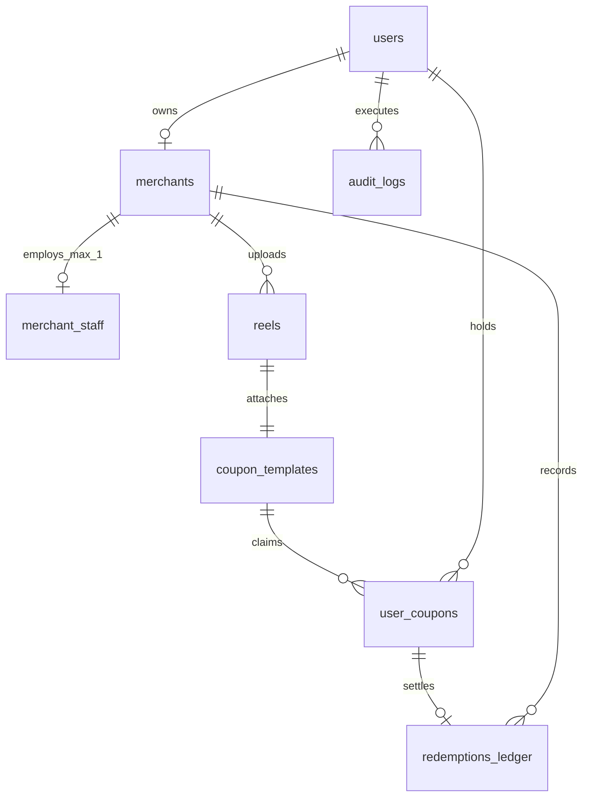

# 06 - Database Design Document

> **Database Engine**: PostgreSQL 16 + PostGIS Extension  
> **Naming Conventions**: `snake_case` for tables and columns, plural table names, UUID primary keys.

---

## 1. Entity-Relationship Model Overview



---

## 2. Table Specifications & Schemas

### 2.1 `users`
Core user account record supporting shoppers, merchants, and administrators.

| Column | Type | Constraints | Description |
|---|---|---|---|
| `id` | `UUID` | `PRIMARY KEY DEFAULT gen_random_uuid()` | Unique user identifier |
| `phone` | `VARCHAR(15)` | `UNIQUE NOT NULL` | Indian phone number with prefix (`+919876543210`) |
| `full_name` | `VARCHAR(100)` | `NULL` | User's full name |
| `email` | `VARCHAR(255)` | `NULL` | Optional email address |
| `password_hash` | `VARCHAR(255)` | `NULL` | Bcrypt hash for Super Admin / credential logins |
| `role` | `VARCHAR(20)` | `NOT NULL DEFAULT 'SHOPPER'` | Enum: `SHOPPER`, `MERCHANT`, `SUPER_ADMIN` |
| `preferred_language` | `VARCHAR(5)` | `NOT NULL DEFAULT 'en'` | Enum: `en`, `hi`, `mr` |
| `is_active` | `BOOLEAN` | `NOT NULL DEFAULT true` | Account status flag |
| `created_at` | `TIMESTAMPTZ` | `NOT NULL DEFAULT NOW()` | Record creation timestamp |
| `updated_at` | `TIMESTAMPTZ` | `NOT NULL DEFAULT NOW()` | Record update timestamp |

---

### 2.2 `merchants`
Business entity associated with a merchant user account.

| Column | Type | Constraints | Description |
|---|---|---|---|
| `id` | `UUID` | `PRIMARY KEY DEFAULT gen_random_uuid()` | Unique merchant identifier |
| `user_id` | `UUID` | `UNIQUE NOT NULL REFERENCES users(id)` | Owner user account |
| `business_name` | `VARCHAR(150)` | `NOT NULL` | Registered trading name of store |
| `sector` | `VARCHAR(30)` | `NOT NULL` | Enum: `FOOD`, `FASHION`, `FOOTWEAR`, `ELECTRONICS`, `REAL_ESTATE` |
| `address_text` | `TEXT` | `NOT NULL` | Full physical street address |
| `city` | `VARCHAR(50)` | `NOT NULL` | Beta city (`Nagpur`, `Mumbai`) |
| `location` | `geography(Point, 4326)` | `NOT NULL` | WGS84 GPS coordinate point (Lon, Lat) |
| `gstin` | `VARCHAR(20)` | `NULL` | GST identification number |
| `kyc_doc_url` | `VARCHAR(500)` | `NOT NULL` | Cloudinary secure URL for GST/Gumasta document |
| `kyc_status` | `VARCHAR(20)` | `NOT NULL DEFAULT 'PENDING'` | Enum: `PENDING`, `APPROVED`, `REJECTED` |
| `kyc_rejection_reason` | `TEXT` | `NULL` | Admin remarks if rejected |
| `created_at` | `TIMESTAMPTZ` | `NOT NULL DEFAULT NOW()` | Timestamp created |
| `updated_at` | `TIMESTAMPTZ` | `NOT NULL DEFAULT NOW()` | Timestamp updated |

---

### 2.3 `merchant_staff`
Store POS cashier and accountant credentials. Strictly 1 staff per merchant in Beta.

| Column | Type | Constraints | Description |
|---|---|---|---|
| `id` | `UUID` | `PRIMARY KEY DEFAULT gen_random_uuid()` | Unique staff identifier |
| `merchant_id` | `UUID` | `UNIQUE NOT NULL REFERENCES merchants(id) ON DELETE CASCADE` | Associated store (Max 1 per merchant) |
| `staff_name` | `VARCHAR(100)` | `NOT NULL` | Cashier or manager name |
| `phone` | `VARCHAR(15)` | `NOT NULL` | Staff personal phone |
| `pin_hash` | `VARCHAR(255)` | `NOT NULL` | Bcrypt/Argon2 hash of 6-digit scanner PIN |
| `is_active` | `BOOLEAN` | `NOT NULL DEFAULT true` | Active toggle |
| `created_at` | `TIMESTAMPTZ` | `NOT NULL DEFAULT NOW()` | Timestamp created |
| `updated_at` | `TIMESTAMPTZ` | `NOT NULL DEFAULT NOW()` | Timestamp updated |

---

### 2.4 `reels`
Short video reels uploaded by verified merchants.

| Column | Type | Constraints | Description |
|---|---|---|---|
| `id` | `UUID` | `PRIMARY KEY DEFAULT gen_random_uuid()` | Unique reel identifier |
| `merchant_id` | `UUID` | `NOT NULL REFERENCES merchants(id) ON DELETE CASCADE` | Creator merchant |
| `title` | `VARCHAR(150)` | `NOT NULL` | Reel headline / caption |
| `duration_seconds` | `SMALLINT` | `NOT NULL CHECK (duration_seconds BETWEEN 15 AND 60)` | Video length (15 to 60s) |
| `video_url` | `VARCHAR(500)` | `NOT NULL` | Streamable MP4/WebM video CDN URL |
| `video_hls_url` | `VARCHAR(500)` | `NULL` | Future HLS `playlist.m3u8` CDN URL (deferred) |
| `thumbnail_url` | `VARCHAR(500)` | `NOT NULL` | Poster thumbnail CDN URL |
| `audio_type` | `VARCHAR(20)` | `NOT NULL` | Enum: `CAMERA_MIC`, `VOICEOVER` |
| `status` | `VARCHAR(30)` | `NOT NULL DEFAULT 'PENDING_MODERATION'` | Enum: `PENDING_MODERATION`, `APPROVED`, `REJECTED` |
| `rejection_reason` | `TEXT` | `NULL` | Admin rejection feedback |
| `views_count` | `INTEGER` | `NOT NULL DEFAULT 0` | Total shopper view impressions |
| `created_at` | `TIMESTAMPTZ` | `NOT NULL DEFAULT NOW()` | Upload timestamp |
| `updated_at` | `TIMESTAMPTZ` | `NOT NULL DEFAULT NOW()` | Update timestamp |
| `deleted_at` | `TIMESTAMPTZ` | `NULL` | Soft-delete timestamp |

---

### 2.5 `coupon_templates`
Offer rules and terms attached to an approved reel.

| Column | Type | Constraints | Description |
|---|---|---|---|
| `id` | `UUID` | `PRIMARY KEY DEFAULT gen_random_uuid()` | Unique template identifier |
| `merchant_id` | `UUID` | `NOT NULL REFERENCES merchants(id) ON DELETE CASCADE` | Merchant issuing offer |
| `reel_id` | `UUID` | `UNIQUE NOT NULL REFERENCES reels(id) ON DELETE CASCADE` | 1-to-1 attached reel |
| `title` | `VARCHAR(100)` | `NOT NULL` | E.g., "Flat 20% Off Festive Wear" |
| `discount_type` | `VARCHAR(20)` | `NOT NULL` | Enum: `PERCENTAGE`, `FLAT_AMOUNT`, `BOGO` |
| `discount_value` | `NUMERIC(10, 2)` | `NOT NULL CHECK (discount_value > 0)` | % or ₹ discount value |
| `min_order_amount` | `NUMERIC(10, 2)` | `NOT NULL DEFAULT 0.00` | Minimum bill requirement in ₹ |
| `validity_days` | `SMALLINT` | `NOT NULL` | Max days valid from claim (Sector constrained) |
| `terms` | `TEXT` | `NULL` | Specific conditions & exclusions |
| `is_active` | `BOOLEAN` | `NOT NULL DEFAULT true` | Availability toggle |
| `created_at` | `TIMESTAMPTZ` | `NOT NULL DEFAULT NOW()` | Timestamp created |
| `updated_at` | `TIMESTAMPTZ` | `NOT NULL DEFAULT NOW()` | Timestamp updated |

---

### 2.6 `user_coupons`
Individual instances of coupons claimed by shoppers into their wallet.

| Column | Type | Constraints | Description |
|---|---|---|---|
| `id` | `UUID` | `PRIMARY KEY DEFAULT gen_random_uuid()` | Unique coupon claim identifier |
| `coupon_template_id` | `UUID` | `NOT NULL REFERENCES coupon_templates(id)` | Parent coupon definition |
| `user_id` | `UUID` | `NOT NULL REFERENCES users(id)` | Claiming shopper |
| `status` | `VARCHAR(20)` | `NOT NULL DEFAULT 'CLAIMED'` | Enum: `CLAIMED`, `REDEEMED`, `EXPIRED` |
| `totp_secret` | `VARCHAR(64)` | `NOT NULL` | Base32 secret for 60s dynamic QR code |
| `claimed_at` | `TIMESTAMPTZ` | `NOT NULL DEFAULT NOW()` | Claim timestamp |
| `expires_at` | `TIMESTAMPTZ` | `NOT NULL` | Exact expiration timestamp |
| `redeemed_at` | `TIMESTAMPTZ` | `NULL` | In-store verification timestamp |
| `redeemed_by_staff_id` | `UUID` | `NULL REFERENCES merchant_staff(id)` | Staff terminal verifying code |

---

### 2.7 `redemptions_ledger`
Immutable financial and audit ledger verifying each physical in-store redemption.

| Column | Type | Constraints | Description |
|---|---|---|---|
| `id` | `UUID` | `PRIMARY KEY DEFAULT gen_random_uuid()` | Unique ledger entry identifier |
| `user_coupon_id` | `UUID` | `UNIQUE NOT NULL REFERENCES user_coupons(id)` | Target claimed coupon |
| `merchant_id` | `UUID` | `NOT NULL REFERENCES merchants(id)` | Merchant honoring discount |
| `staff_id` | `UUID` | `NULL REFERENCES merchant_staff(id)` | Staff member who scanned QR |
| `discount_applied` | `NUMERIC(10, 2)` | `NOT NULL` | Value of discount granted |
| `verified_location` | `geography(Point, 4326)`| `NULL` | GPS coordinates of cashier during scan |
| `distance_from_shop_m`| `INTEGER` | `NULL` | Distance offset in meters (anti-spoof check) |
| `created_at` | `TIMESTAMPTZ` | `NOT NULL DEFAULT NOW()` | Immutable timestamp |

---

### 2.8 `audit_logs`
Super admin actions tracking moderation decisions.

| Column | Type | Constraints | Description |
|---|---|---|---|
| `id` | `UUID` | `PRIMARY KEY DEFAULT gen_random_uuid()` | Unique audit log identifier |
| `admin_id` | `UUID` | `NOT NULL REFERENCES users(id)` | Acting super admin |
| `target_type` | `VARCHAR(30)` | `NOT NULL` | Enum: `REEL`, `MERCHANT_KYC`, `USER_SUSPEND` |
| `target_id` | `UUID` | `NOT NULL` | UUID of entity altered |
| `action` | `VARCHAR(30)` | `NOT NULL` | Enum: `APPROVE`, `REJECT`, `SUSPEND` |
| `notes` | `TEXT` | `NULL` | Written justification |
| `created_at` | `TIMESTAMPTZ` | `NOT NULL DEFAULT NOW()` | Log timestamp |

---

## 3. Database Indexes & Performance Optimization

```sql
-- Spatial GIST index for fast radius queries
CREATE INDEX idx_merchants_location ON merchants USING GIST(location);

-- Feed filtering & sorting indexes
CREATE INDEX idx_reels_status_created ON reels(status, created_at DESC) WHERE deleted_at IS NULL;
CREATE INDEX idx_reels_merchant_id ON reels(merchant_id);

-- Coupon lookup & expiration indexes
CREATE INDEX idx_user_coupons_user_status ON user_coupons(user_id, status);
CREATE INDEX idx_user_coupons_expires_at ON user_coupons(expires_at) WHERE status = 'CLAIMED';

-- Ledger lookup
CREATE INDEX idx_ledger_merchant_date ON redemptions_ledger(merchant_id, created_at DESC);
```

---

## 4. Sector Validity Check Trigger

```sql
CREATE OR REPLACE FUNCTION validate_coupon_sector_validity()
RETURNS TRIGGER AS $$
DECLARE
    m_sector VARCHAR(30);
BEGIN
    SELECT sector INTO m_sector FROM merchants WHERE id = NEW.merchant_id;
    
    IF m_sector = 'FOOD' AND NEW.validity_days > 5 THEN
        RAISE EXCEPTION 'Food & Dining coupons cannot exceed 5 days validity.';
    ELSIF m_sector IN ('FASHION', 'FOOTWEAR', 'ELECTRONICS') AND NEW.validity_days > 15 THEN
        RAISE EXCEPTION '% coupons cannot exceed 15 days validity.', m_sector;
    ELSIF m_sector = 'REAL_ESTATE' AND NEW.validity_days > 60 THEN
        RAISE EXCEPTION 'Real Estate coupons cannot exceed 60 days validity.';
    END IF;

    RETURN NEW;
END;
$$ LANGUAGE plpgsql;

CREATE TRIGGER trg_check_coupon_sector_validity
BEFORE INSERT OR UPDATE ON coupon_templates
FOR EACH ROW
EXECUTE FUNCTION validate_coupon_sector_validity();
```
